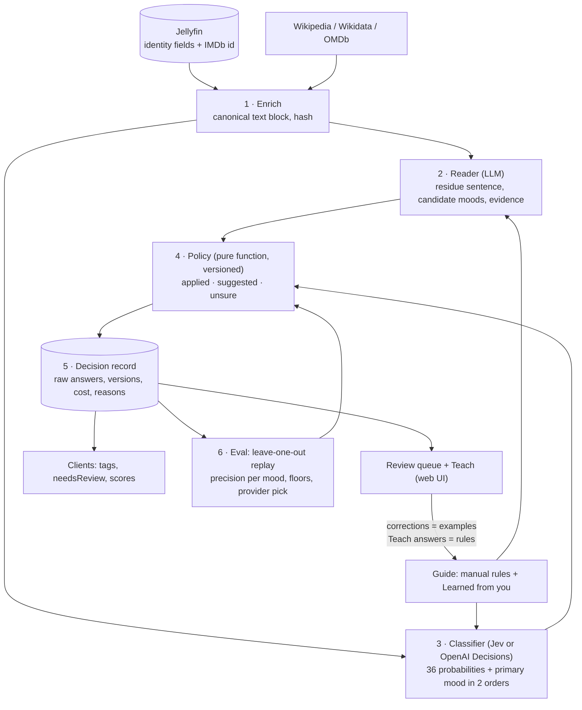

# Spec: Mood tagger rewrite (text block, decision classifier, reader, policy, learning loop)

> Status: **phase 1 implemented 2026-10-21** on branch `gkl_tagger_rewrite` (enrichment, reader v2, policy `p-legacy`, decisions store, label provenance, persisted runs, settings and web UI; see `docs/sessions/2026-10-21-tagger-phase-1.md`). The live run on the owner's library (plan Task 17) is pending. Phases 2 to 4 (classifier providers, policies `p0`/`p1`, eval, Teach) are not started. Replaces the single-model auto-tagger (`LLMService` + `SuggestionService`) with a measurable, teachable pipeline modelled on the X-Cache Live classifier. Server-only. The iOS client contract stays additive. Companion design in the mobile repo: `docs/superpowers/specs/2026-04-24-nocturne-north-star-design.md` (design principle #3: Jellyfin is the source of truth, Nocturne is the editorial layer).

## Context

The tagger is the only model-backed feature in the whole Nocturne system. Today it is one prompt per film on a single model, with no ground truth, no measurement and no teaching mechanism. The rewrite exists for three reasons, in priority order:

1. **Robustness.** Every decision must be stored raw, replayable and undoable. A film must land where it belongs for a reason the admin can read.
2. **Teaching.** Corrections must generalise. Teaching 30 boundary cases should fix 700 films, through examples and written rules, never by relabelling the library.
3. **Cost.** A side effect of the design, not its goal. Today's defaults cost about $390 per 5,000 films; the new pipeline lands near $10.

### What exists today

- `LLMService.swift:12` defaults to `claude-opus-4-7`, changeable only through the `ANTHROPIC_MODEL` env var. No settings UI for model or prompt.
- One prompt of about 10K tokens per film: 1.9K of rules (`Configuration.autoTaggingPrompt`), 7.4K for all 36 buckets with anchors and calibration lines, then the film, then a Wikipedia extract. Nothing is cached, and the prompt order (film before buckets) would defeat prefix caching anyway.
- A self-critique second pass (`refineTags`) on the same model for about a third of films, and a per-tag refinement worker (`startTagRefinement`) that asks the same model once per film carrying a tag. Same model judging its own pick.
- Auto-apply gate is the model's self-reported confidence at or above 0.72. Not calibrated.
- `SuggestionService.swift:194` writes strong rows as `approved` with `resolvedAt` set at creation, identical to a human approval. `buildCalibration` then feeds the model its own picks back as "you approved this tag". Human signal today is only `movie_tags.addedByAutoTag == false` and `rejected` rows.
- `fetchExternalSummary` (`LLMService.swift:519`) tries "Title (Year)", which always 404s on Wikipedia, then the bare title. Verified live: Heat returns the thermodynamics article, Drive returns a disambiguation stub. The prompt then asks the model to cite evidence from that text.
- The Jellyfin overview is a spoiler-free pitch. The residue moods (bittersweet-aftermath versus emotional-gut-punch) are decided by endings, and the five acclaim moods (modern-masterpieces, film-school-shelf, regional-gems, cult-chaos, underseen-treasures) are decided by reception. Neither is in the overview.

### Verified inputs (2026-10-21)

Resolving a film from its IMDb id through Wikidata to the exact English Wikipedia page, then fetching the full article as plain text, gives a complete spoiler plot plus reception and accolades sections, free, about 1.5 s per film:

| Film | Page | Plot words | Reception words | Wikidata awards |
|---|---|---|---|---|
| Heat | Heat (1995 film) | 655 | 524 | none |
| Drive | Drive (2011 film) | 566 | 1,330 | 2 won, 2 nominated |
| Parasite | Parasite (2019 film) | 689 | 1,844 | 14 won, 8 nominated |
| Nayakan | Nayakan | 601 | 660 | 1 nominated |
| Kadaisi Vivasayi | Kadaisi Vivasayi | 492 | 411 | none |

Structured awards on Wikidata are clean where present but patchy for regional and older films; the prose accolades section is the complete source. OMDb's `Awards` string ("Won 4 Oscars. 309 wins & 271 nominations total") is already in the response the ratings proxy fetches; `APIRoutes.swift:323` decodes only `Ratings` and drops it.

## Resolved scope

- **In:** movies only (NocturneServer has no series model). Single admin. Web UI for review and Teach. Two LLM providers (Anthropic, one OpenAI-compatible endpoint) plus two decision classifiers (Jev, OpenAI Decisions) behind one interface. Wikipedia and Wikidata enrichment. Eval harness. Learned rules in the guide. Targeted re-grade.
- **Out, parked:** embeddings and semantic or voice search (decided 2026-10-21). Per-user labels. Taxonomy editing in the UI (add, merge, rename moods); from phase 1 the taxonomy lives in `Resources/taxonomy.json` with a version and is edited by hand. In-app Teach on iOS. Batch API for backfill (open question). TV shows.
- **Client contract:** `GET /api/v1/clients/tags` and `POST /api/v1/clients/tags/batch` keep `{ jellyfinId, tags, needsReview }`. One additive field, `scores` (mood slug to probability for applied tags), lands in phase 2. Old app builds ignore it.

## Architecture



Every layer reads the same text block. No layer's answer alone applies a tag. The policy is the only place a tag is decided, and it is a pure function of stored answers, so it can be replayed.

## 1. Enrichment

### Resolution

1. Read `ProviderIds.Imdb` (and `Tmdb`) from the Jellyfin item. The sync already requests `ProviderIds`.
2. Wikidata: `action=query&list=search&srsearch=haswbstatement:P345=<imdb>` gives the QID. If no IMDb id, `srsearch=haswbstatement:P4947=<tmdb>`. If neither, `wbsearchentities` by title, keep candidates whose `P31` is a film subclass and whose `P577` year is within one year of Jellyfin's `ProductionYear`; ambiguous results are left unresolved for the admin.
3. `wbgetentities&props=sitelinks|claims&sitefilter=enwiki|tawiki|mlwiki|hiwiki|knwiki|tewiki|bnwiki` in one call. English page preferred; the first non-English sitelink is the fallback page.
4. The admin can override the page title per film from the movie detail view; an override wins over resolution and survives re-runs.

### Fetch

- Article text: `action=query&prop=extracts&explaintext=1&exsectionformat=wiki&redirects=1&titles=<title>` on the resolved wiki. Split on `== Heading ==` lines.
- Plot: the first section whose heading matches `plot|synopsis|story|premise`. Capped at 2,500 words (keep the beginning and the end if longer, the ending matters most).
- Reception: every section whose heading matches `reception|critical|accolades|awards|legacy|release|box office`, concatenated, capped at 800 words.
- Structured awards: `P166` (award received) and `P1411` (nominated for) from the entity claims fetched in step 3, with the `P585` year qualifier. Award labels resolved with one batched `wbgetentities` per 50 QIDs and cached in a small `wikidata_labels` table.
- OMDb `Awards`: extend `RawOmdbResponse` with `Awards: String?`, store it next to the ratings in `omdb_cache` (new column `awards`, nullable). The ratings proxy keeps filling the cache when a client opens a film; enrichment also fetches OMDb directly on a cache miss when a key exists, best-effort, capped at 900 calls per day (free tier: 1,000), so a fresh library fills in over a few coverage runs and the ratings cache fills with it.
- Wikimedia etiquette: a descriptive `User-Agent` with a contact address, at most 2 requests per second per wiki, honour `Retry-After` and `maxlag` errors with backoff.

### Canonical text block

Deterministic plain text with fixed headings, the same bytes for every model and for the hash. Everything from Jellyfin is identity, not story.

```
# Identity
Title: Heat (1995) · Original title: Heat
Director: Michael Mann · Runtime: 170 min · Genres: Crime, Drama, Thriller
Cast: Al Pacino, Robert De Niro, Val Kilmer, Jon Voight, Tom Sizemore
Language: en · Country: US

# Overview (Jellyfin, spoiler-free)
<overview>

# Plot (Wikipedia, full, contains spoilers)
<plot>

# Reception and acclaim (Wikipedia)
<reception>

# Awards (structured)
Won: (none)
Nominated: (none)
OMDb: <summary string, for example "Won 4 Oscars. 309 wins & 271 nominations total">

# Source
Page: Heat (1995 film) (en) · fetched 2026-10-21 · verified
```

Rules: headings and order are fixed; a missing section is written as `(none)`; the `Source` line carries `verified` for Wikipedia text, `unverified` for model-written text; `input_hash` is SHA-256 of the block. Budget: about 6K tokens at the caps above.

### Fallback for films with no plot anywhere

A strong model (default `claude-opus-5-5`, selectable `claude-sonnet-5-5`) with the Anthropic web search tool writes a full plot including the ending and a reception paragraph, from sources it cites. Stored as `source = model`, `unverified = true`. The review queue shows an `unverified source` badge on those films and the policy never auto-applies for them (everything becomes a suggestion). This is the only place a model writes story text.

### Storage

New table `movie_enrichment`, one row per film:

| Column | Notes |
|---|---|
| `jellyfin_id` PK | FK to `movies` |
| `imdb_id`, `tmdb_id`, `wikidata_qid` | nullable |
| `wiki_site`, `wiki_title`, `wiki_title_override` | override wins |
| `identity_json` | the identity fields used to build the block, refreshed from Jellyfin on every build |
| `overview_text`, `plot_text`, `reception_text` | capped as above |
| `awards_json` | `[{ name, kind: won|nominated, year }]` |
| `omdb_awards` | string, nullable |
| `text_block`, `input_hash` | the block and its SHA-256 |
| `source`, `unverified` | `wikipedia`, `wikipedia_other_lang`, `model`, `none` |
| `enrich_version` | bump when the block format changes; forces a rebuild |
| `fetched_at`, `error` | last fetch time, last error text |

Re-enrich when Jellyfin's `DateLastSaved` changes, when `enrich_version` changes, when the admin overrides the page, or on manual refresh. Re-classify only when `input_hash`, `taxonomy_version`, `guide_version` or `policy_version` changes. Storing the overview and identity is classifier input, not a catalogue the clients read; client endpoints never return any of it.

### Coverage dry run

A run of kind `enrich-coverage` resolves and fetches every film without any model call and reports: English plot found, non-English plot only, resolved but no plot section, unresolved. Its per-film list is the admin's worklist for page overrides. This is the first thing to run on a library after phase 1 ships, and it sizes the fallback.

## 2. Reader (LLM)

Role: read the block, state the residue in one sentence, name 1 to 5 candidate moods with an evidence phrase each. Its confidence numbers are not used by the policy.

- **Prompt.** The existing residue-first rules, disambiguation pairs and per-bucket definitions with `anchorsFit` and `anchorsMiss` stay as they are. Deleted: the self-critique pass, the keyword post-filter, the "Min confidence" lines, Rule 7. The rules and bucket definitions move into the `system` block with `cache_control` on it (static prefix, about 9K tokens, above every model's minimum cacheable size). The `user` turn holds, in this order: the guide's "Learned from you" rules, calibration lines (films the admin confirmed or rejected per mood, human-sourced only, at most 5 and 3 per mood), then the text block.
- **Output.** Structured output (`output_config.format`) with a fixed JSON schema: `{ residue, candidates: [{ slug, evidence }], alternates: [slug] }`. No prefill. Effort `low`.
- **Spoiler rule.** The residue sentence is written under "describe the feeling, never an event after the first act". It is the only reader text that may reach a screen.
- **Model.** Settings-selectable. Anthropic default `claude-haiku-5-5`; `claude-sonnet-5-5` and `claude-opus-5-5` selectable. OpenAI-compatible endpoint with base URL, key and model name (for example `gpt-6-luna`), JSON mode. Temperature 0 where the provider supports it.
- **Verification.** Log `usage.cache_read_input_tokens` on every Anthropic call; a backfill with zero cache reads after the second film is a bug.

## 3. Classifier of record (Jev or OpenAI Decisions)

Two vendors ship the same primitive: a block of text plus named questions in, a probability per question out. Both are weeks old (Jev early access since 2026-09-15, OpenAI Decisions public beta since 2026-10-06), neither has been tested on long inputs with many subjective questions, and the one independent benchmark found (short routing cases, akitaonrails 2026-10-10) puts Jev a few points ahead at a similar price. The server therefore implements both behind one interface, and the eval (section 7) picks the default on the admin's own labels.

- **Interface.** `DecisionClassifier`: `classify(state: String, questions: [Question]) -> ClassifierAnswer`. A question is `predicate(name, text)` or `choice(name, text, options)`. An answer carries `probabilities[name]`, `choices[name]` with its per-option distribution, `refusals`, `provider`, `model`, `usage`. The policy and the decision record only ever see this shape.
- **Jev (TypeSafe).** `POST /v1/systemone`, model pinned (`jev-1.13.0` at time of writing), 64K context with at most 32K for state plus the longest question, Noul for yes/no, Choice up to 255 options. Published input price $0.042 per million tokens. TypeSafe's own jaggedness notes: literal reading, no counting, dates as text, accuracy drops when the state carries irrelevant material, steerable by adversarial text in state. The last two matter here: the reception section is irrelevant to most residue questions, and Wikipedia text is third-party. Both are eval questions, not assumptions.
- **OpenAI Decisions.** `POST /v1/decisions`, `gpt-6-luna` only, 1 to 400 questions per request, predicate for yes/no, choice with per-option probabilities and a confidence, score for ordered levels. Any question may return a refusal while the others answer; a refused mood is treated as "no answer" (never applied, never suggested) and logged. Text and inline images. Prompt caching with an implicit breakpoint. Published input price $0.10 per million tokens, output and cache reads free. The probabilities are not documented as calibrated; thresholds come from the eval either way. Shares the OpenAI key with the reader when the reader endpoint is OpenAI.
- **State, identical for both.** The text block plus the guide (manual rules and learned rules). No calibration titles; human labels reach the classifier as examples only through the guide's learned rules and, if the eval shows it helps, as a short "confirmed / rejected" list appended to the state (open question).
- **Questions, identical for both, one request per film.**
  - 36 yes/no questions, one per mood. The question text carries the bucket's title, residue description, keywords and "not for" anchors. Answer: probability of yes.
  - `primary_pass1`: a choice over all 36 moods in taxonomy order. `primary_pass2`: the same choice with the options shuffled by a seed derived from `jellyfinId`. Disagreement is the unsure signal.
- **Size.** About 6K tokens of state plus about 7K of question text. Inside Jev's limits with room to spare, far inside OpenAI's.
- **Selection.** Setting `classifier.provider` (`jev`, `openai`, `none`). The eval run can classify with both providers in one pass and report them side by side; the admin picks the default from the report.
- **Absent key.** No classifier key means the policy runs in reader-only mode (`pr`): nothing auto-applies, every candidate is a suggestion. Self-hosters with neither key keep a working server.
- **Raw storage.** The full response, with provider and model version, in `decisions.classifier_json`. A second provider's answers for the same film go in a second decision row with the same `input_hash`, so replay can compare them.

## 4. Policy

A pure function `(reader, classifier, floors, high, policyVersion) -> Decision`, versioned, with table-driven tests. No I/O.

```
for mood in taxonomy:
  p        = classifier.probability[mood]   (nil when no classifier ran, or the question was refused)
  inReader = reader.candidates contains mood
  if p != nil:
    if inReader and p >= floor[mood]:  applied   (reason: "reader yes, classifier 0.81 ≥ 0.70")
    elif inReader and p <  floor[mood]: suggested (reason: "reader yes, classifier 0.58 < 0.70")
    elif !inReader and p >= high[mood]: suggested (reason: "classifier 0.91, reader silent")
    else: none
  else:                                   (policy pr)
    if inReader: suggested
applied   = top 5 of applied by p
unsure    = classifier.primary_pass1 != classifier.primary_pass2 or applied is empty
outcome   = applied empty ? (suggested empty ? none : review)
          : (suggested empty and !unsure ? applied : review)
if enrichment.unverified: move every applied mood to suggested, outcome = review
```

- **Versions.** `p1` (above, reader plus classifier, default). `p0` (classifier only: `p >= floor` applied, `floor - 0.10 <= p < floor` suggested). `pr` (reader only). The eval replays all three over the same stored answers.
- **Floors.** Settings `policy.floors` and `policy.high`, per mood. Initial values: 0.70 for every mood, 0.80 for the moods that today carry `minConfidence 0.82` (crime-grit-style, slow-burn-sharp-blade, ha-ha-ha, film-school-shelf, regional-gems, bittersweet-aftermath), `high` 0.85 everywhere. Phase 3 replaces them with eval-derived values, per provider.
- **Human precedence.** A mood with `label_source = user` is never auto-removed by any later decision. A re-grade that drops an auto-applied mood below its floor produces a removal suggestion, never a silent removal.
- **Client mapping.** `tags` = applied slugs ordered by probability, at most 5. `needsReview` = outcome is `review` or `unsure`. `scores` = `{ slug: p }` for applied tags (additive, phase 2).

## 5. Decision record and storage

New tables (numbered forward-only migrations, as today):

| Table | One row per | Key columns |
|---|---|---|
| `decisions` | classification attempt | `id`, `jellyfin_id`, `run_id`, `input_hash`, `enrich_version`, `taxonomy_version`, `guide_version`, `policy_version`, `classifier_provider`, `reader_json`, `classifier_json`, `applied_json`, `suggested_json`, `unsure`, `outcome` (`applied`, `review`, `none`, `error`, `skipped`), `reasons_json`, `models_json`, `cost_usd`, `created_at` |
| `api_calls` | outbound attempt | `id`, `run_id`, `decision_id`, `provider`, `endpoint`, `model`, `attempt`, `http_status`, `duration_ms`, `units_json` (tokens, cache reads, questions), `cost_usd`, `created_at`. Never bodies, headers or keys. |
| `runs` | job | `id`, `kind` (`backfill`, `reprocess`, `regrade`, `eval`, `enrich-coverage`, `teach`), `trigger`, `status`, `params_json`, `stats_json`, `cost_json` (per provider), `cancel_requested`, `started_at`, `finished_at`. Replaces the in-memory `BackfillStateActor`; progress survives a restart. |
| `teach_answers` | one-tap answer | `id`, `jellyfin_id`, `boundary` (`slugA|slugB`), `answer` (`slugA`, `slugB`, `neither`), `decision_id`, `created_at` |
| `wikidata_labels` | award QID | `qid`, `label`, `fetched_at` |

Changed tables:

- `movies`: add `current_decision_id`.
- `movie_tags`: add `label_source` (`seed`, `auto`, `user`). Migration: `addedByAutoTag = true` becomes `auto`, `false` becomes `user`. `addedByAutoTag` stays for one release, then goes.
- `tag_suggestions` stays the review queue. Add `decision_id`, `resolved_by` (`auto`, `user`), `items_json` (`[{ slug, probability, evidence, kind: add|remove }]`). Migration for existing rows: `resolved_by = auto` where `status = approved` and `resolvedAt - createdAt < 2 s` (auto rows set both at creation), otherwise `user`. `reasoning` keeps the residue sentence.
- `omdb_cache`: add `awards`.
- `settings`: `guide.manual` (seeded from `Resources/guide.md`), `guide.learned` (JSON rules), `guide.version`, `taxonomy.version`, `policy.version`, `policy.floors`, `policy.high`, `models.reader`, `models.strong`, `classifier.provider`, `classifier.jev_model`, `classifier.openai_model`, `providers.openai_base_url`, `budget.monthly_usd`.

Secrets (Anthropic, OpenAI, Jev, OMDb keys) stay in `SecretsManager`, each with a Test button in Settings. The OpenAI key serves both the Decisions endpoint and the reader when the reader's base URL points at OpenAI.

Two habits, taken from X-Cache: every model answer is stored raw next to the derived outcome, so policies can be replayed; every cost is metered per call, so the monthly budget is exact and scheduled work pauses when it is reached.

## 6. Learning loop

### Corrections become examples instantly

Approving, rejecting, adding or removing a mood in the review queue writes `label_source = user` on the tag, sets `resolved_by = user` on the suggestion, and writes a `corrections`-style reason into the decision's `reasons_json`. The next reader call for any film sees the title in its calibration lines. No retraining, no extra call.

### Teach turns boundaries into rules

- **Candidates.** Films where the admin's final moods differ from the system's applied set, plus films in `review` or `unsure`.
- **Boundary.** For each candidate, the pair is (system's top mood, admin's mood) when both belong to a known close pair (the Rule 4 list: bittersweet-aftermath versus emotional-gut-punch, one-room versus psychological pressure-cooker, the-twist-is-the-plot versus brainmelt-zone, horror-and-unease versus uncanny-vibes, vibe-is-the-plot versus visual-worship, modern-masterpieces versus film-school-shelf, regional-gems versus underseen-treasures, crime-grit-style versus antihero-study), otherwise the classifier's top two moods.
- **Screen.** Grouped by boundary, one tap per film: left mood, right mood, neither. Shows the residue sentence and the two probabilities.
- **Rules.** Per boundary with at least three answers, the strong model reads the boundary definitions, the manual guide, and the answered films with their residue sentences, and writes up to three rules that explain the answers without contradicting the manual guide. Rules are previewed, editable, and accepted one by one into `guide.learned`, which bumps `guide.version`.
- **Guide.** `guide.manual` is seeded from `Resources/guide.md` (the current prompt text, moved out of Swift in phase 1) and becomes editable in Settings here. `guide.learned` renders under it as "Learned from you". Both the reader and the classifier read the full guide.

### Targeted re-grade

A guide or floor change triggers a `regrade` run over films whose top two classifier moods touch the changed boundary. Re-grade calls the classifier only and reuses the stored `reader_json` unless `input_hash` changed. Additions follow the policy; removals always become suggestions. This replaces the per-tag refinement worker.

### Realtime

The existing Jellyfin WebSocket hook keeps enqueueing new and updated films. The job is now: enrich (if the hash changed), reader, classifier, policy, decision. A failed layer marks that film `error` for retry on the next run; a 401 or 403 from any provider stops the run.

## 7. Eval

- **Dataset.** Human labels only: `movie_tags.label_source = user`, suggestions with `resolved_by = user`, and rejections. Auto-sourced rows are never ground truth.
- **Leave-one-out.** An `eval` run re-classifies every labelled film with that film's own label removed from the calibration lines and the learned rules it contributed to. Reader and classifier are called fresh, with both classifier providers when both keys exist; this is the only part of the eval that spends money.
- **Replay.** Over the stored answers, replay policy versions `p0`, `p1`, `pr` and a floor grid (0.50 to 0.90 in steps of 0.05) without any model call, per provider.
- **Metrics per mood, per provider and per setting.** Precision, recall, auto-apply rate, Wilson lower bound (z = 1.96), and Brier score of the classifier's probability against the human label (calibration). The five acclaim moods and the residue pairs are reported as their own rows. Settings that reach the target precision (default 0.85 lower bound) are flagged; the admin picks floors from the flagged set, or accepts the suggested ones.
- **Provider pick.** The report shows the two providers side by side on the same films. The admin sets `classifier.provider` from it; the floors are stored per provider so switching later does not reuse the wrong thresholds.
- **Output.** `runs.stats_json` plus an Eval page in the web UI with the table and the chosen floors. A baseline eval on the current labels runs before the new policy goes live, so the switch is measured, not assumed.

## 8. Providers and operations

- **One outbound wrapper** for Anthropic, OpenAI (Responses and Decisions), OpenAI-compatible endpoints, Jev, Wikimedia, Wikidata and OMDb: timeouts, retries at 1, 2, 4, 8 s with jitter honouring `Retry-After`, one `api_calls` row per attempt, cost from a single price table with the date each price was checked. The existing `callAnthropicText` retry loop folds into it.
- **Anthropic specifics.** Messages API over raw HTTP as today (Swift has no official SDK). `cache_control` on the system block; structured outputs; `output_config.effort: "low"` for the reader; web search tool only on the strong-model fallback.
- **Classifier specifics.** Request and response shapes for both vendors confirmed against their API references during planning; `classifier_json` stores whatever comes back, so a shape change never loses data. Refusals (OpenAI) and truncation or rate-limit errors (Jev, 40 requests per second, 100K tokens per second listed) are recorded per decision.
- **Budget.** `budget.monthly_usd` (default $15). Scheduled and realtime classification pause when the month's metered spend reaches it; manual runs warn and ask.
- **Throughput.** About 5 s per film sequential (Wikipedia 1.5 s, reader 2 to 3 s, classifier under 1 s). Backfill runs with a concurrency of 3 and the Wikimedia rate cap, so a 5,000-film library takes about 2.5 hours end to end. Cancellation and progress live in `runs`.
- **Settings UI.** Keys with Test buttons (Anthropic, OpenAI, Jev, OMDb), reader model picker, strong model picker, classifier provider and model pins, policy version, floors table (read-only until phase 3), monthly budget, guide editor, enrichment coverage summary.
- **Spoiler hygiene.** `text_block`, `plot_text`, evidence phrases and classifier questions are never returned by client endpoints. The admin UI shows the plot behind a "show spoilers" toggle. The residue sentence follows the first-act rule.

## 9. What gets deleted

Shipped code that the new pipeline replaces is removed, not kept behind a flag:

- `LLMService.swift` whole: the reader lives in `Tagger/ReaderService`, HTTP in `Providers/AnthropicClient`.
- `SuggestionService.swift` whole, replaced by `Tagger/TaggerPipeline` (one tagging entry point), `Tagger/ReviewQueue` (pending list, approve, reject, regenerate) and `Runs/BackfillJob`. The per-tag refinement worker, its `tags/:slug/refine*` routes and its UI go with it; targeted re-grade (phase 4) is its replacement, `reprocess-all` covers the gap.
- `BackfillStateActor` (replaced by `runs`).
- The keyword post-filter and the `looksGeneric` self-critique trigger, with no replacement by design.
- `MoodBucket.minConfidence` (replaced by `policy.floors`), Rule 7 and the "Min confidence to apply" lines in the prompt.
- `TagCalibration.buildCalibration` is kept in shape but rewritten to read human-sourced labels only.
- The `ANTHROPIC_MODEL` env var (replaced by `models.reader`; the env var is honoured for one release as the initial setting value, then dropped).

## 10. Phases

Each phase ships on its own and leaves the server working.

1. **Ground truth and input.** `movie_enrichment` plus the resolver, fetchers, text block and coverage run. `decisions`, `api_calls`, `runs`, `label_source`, `resolved_by` with the retro migration. The provider wrapper with metering and budget. The reader rewritten onto the text block with the cache-friendly prompt order, structured outputs and the model picker. Deletions: `LLMService`, `SuggestionService`, `BackfillStateActor`, the refinement worker with its routes and UI, the keyword post-filter. The taxonomy and the manual guide move to `Resources/taxonomy.json` and `Resources/guide.md`, each with a version. Policy runs as a legacy bridge (`p-legacy`: reader candidates against today's floors) until a classifier lands, with every decision recorded. Plan: `docs/superpowers/plans/2026-10-21-tagger-rewrite-phase-1.md`.
2. **Classifier of record.** Both classifier clients (Jev, OpenAI Decisions) behind `DecisionClassifier`, the policy with `p0`, `p1`, `pr`, queue items with probabilities and evidence, `scores` in the client payload, the OpenAI-compatible reader provider.
3. **Measure.** The eval run with the provider comparison, the Eval page, eval-derived floors per provider, the default provider chosen from the report, baseline before switching the default policy to `p1`.
4. **Teach.** Guide editor, Teach screen, rule writing with preview, learned rules in both prompts, targeted re-grade, page override on movie detail.

Later, separate specs: taxonomy change preview and apply, Batch API for backfill, embeddings and the request feature (parked).

## Cost

Per film at phase 2, estimates: Wikipedia and Wikidata free; reader on `claude-haiku-5-5` with the static prefix cached about $0.001; classifier at about 13K tokens per film about $0.0006 on Jev ($0.042 per million) or $0.0013 on OpenAI Decisions ($0.10 per million). About $10 per 5,000 films on either provider, against about $390 today. The eval costs one full pass over labelled films per provider each time it runs. The strong-model fallback costs about $0.05 to $0.10 per film and is rare.

## Testing

- **Unit (NocturneServer tests).** Text block builder against golden files; section parser against saved Wikipedia extracts (Heat, Drive, Parasite, Nayakan, Kadaisi Vivasayi, one stub page, one disambiguation page); hash stability; policy function table tests for every branch and every version, including refused questions; Wilson bound and Brier score; the `resolved_by` retro migration; provider wrapper retries and metering with stubbed HTTP; Jev, OpenAI Decisions, Anthropic and OpenAI-compatible response decoding including refusals and malformed bodies.
- **Integration, on the admin's library.** Coverage dry run report. Baseline eval on current human labels before any policy switch, with both classifier providers. One backfill with the budget cap set low to prove the pause.
- **Web UI.** Pragmatic, as today. Review queue renders probabilities, evidence, unverified badge and page override; Teach groups and records answers; Eval page renders the grid per provider.

## Verification (definition of done)

1. Every film in the admin's library has a `movie_enrichment` row with a `source` value, and the coverage run reports the long tail.
2. Every classification writes a `decisions` row with raw answers, provider and cost; `api_calls` sums to the provider dashboards within a few percent.
3. The eval runs end to end, reports per-mood precision with Wilson bounds and Brier scores for both providers, and the default floors and the default provider come from it.
4. The review queue shows the reason for every applied and suggested mood, and a correction changes the next decision for a similar film without a code change.
5. Teach produces at least one accepted rule that measurably moves a boundary in the eval.
6. Client payloads keep `tags` and `needsReview`; the mobile app runs unchanged against the new server.
7. No dual path: the old self-critique, refinement worker and keyword filter are gone, and the server still tags with no classifier key configured.

## Open questions (deferred to the plan)

1. Question form per provider: Jev Noul versus OpenAI predicate for yes/no, and whether the primary-mood choice needs the two-order trick on both. Decide after reading both API references; the policy only needs a probability per mood.
2. Whether the classifier's state should carry a short confirmed / rejected title list per mood, or rely on learned rules alone. The eval can answer this after phase 3.
3. Whether production runs both providers on every film (double classifier cost, disagreement as a third unsure signal) or only the eval does.
4. Non-English plots (Tamil, Malayalam) sent as-is versus translated by the reader first. Test on real films in phase 1.
5. Batch API for the reader during backfill (50% cheaper, asynchronous) versus the simpler sequential loop.
6. Whether `scores` should ship to the client in phase 2 or wait for the Tonight work that will consume it.
7. The exact plot and reception word caps, once the coverage run shows the real distribution.
